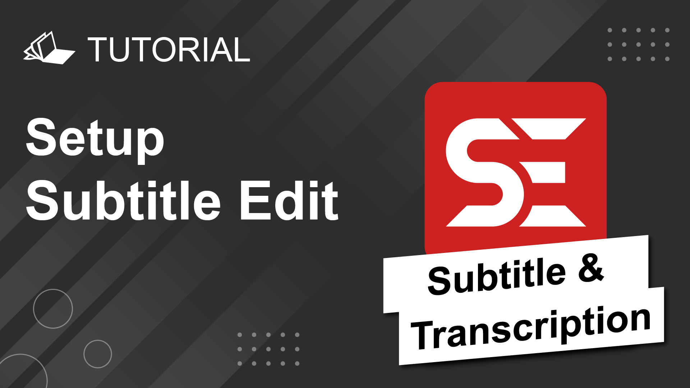
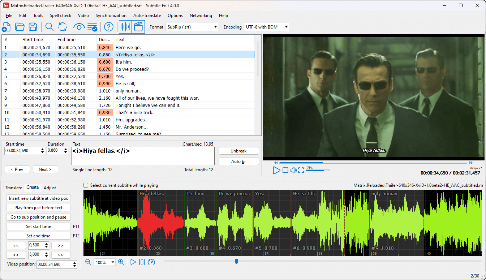
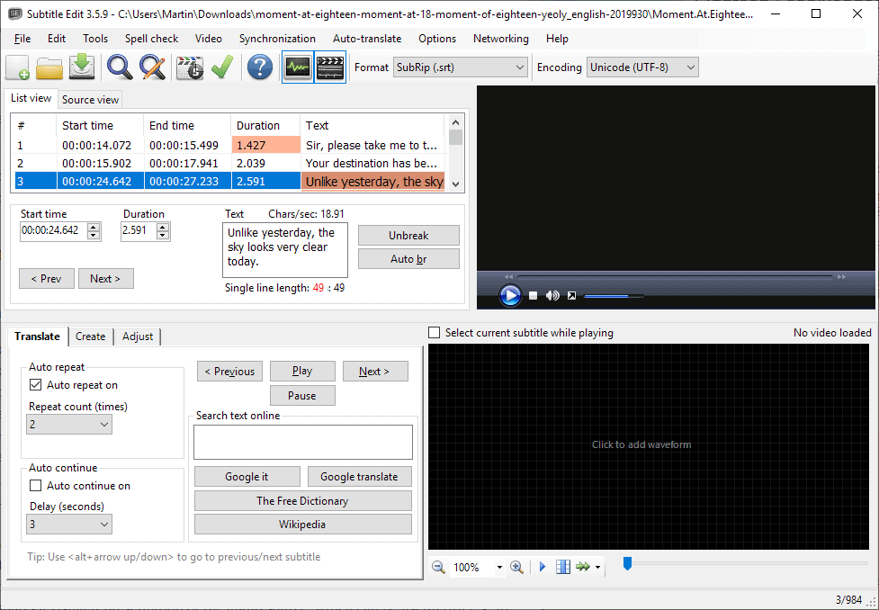

# Edit Subs

Edit Subs is the everyday job of Subtitle Edit Program: open a subtitle file, fix the words, and move the cues so they match the voice. subtitle edit is the name people search. nikse subtitle edit is the same program, from the project that has shipped it for years. subtitle edit software is the desktop app, not a website that keeps your film.

You work on the subtitle file. The video stays beside it so you can hear the line and see the frame. The program does not upload the movie as part of ordinary editing.

A short film, a course, or a series episode is the scale it is built for. It is not a video editor. It will not cut shots. It will write a timed text file you can mux or upload later.

## Documentation and FAQ

The list is the whole document. Each row is a start time, an end time, and the words the viewer reads. Change the words in the grid. Change the times by typing them or by dragging on the audio.

A new file can start empty. Type the first line, set the in and out, and add the next. Or open an SRT, a WebVTT, or one of the many other formats the program already knows. [SubRip.cs](formats/SubRip.cs) reads and writes SRT. [WebVTT.cs](formats/WebVTT.cs) does the same for WebVTT. [WebVttHelper.cs](formats/WebVttHelper.cs) covers the extra WebVTT details, such as cue settings that SRT does not have.

Save often to the format you will deliver. Converting is a save-as, not a second app. Check the result in a player before you delete the original.

Common questions land in a few places:

- A line that shows late is a timing problem, not a font problem.
- A line that shows the wrong words is a text problem. Fix the text, then the time.
- A file that opens as one long paragraph was probably the wrong format. Reopen it with the format you were given.
- Overlap warnings mean two cues occupy the same moment. Shorten one of them.
- A missing character is often the wrong encoding. Pick the encoding that makes the letters look right, then save as UTF-8 if you can.

| Format | What it is for |
| --- | --- |
| SRT | Plain cues, the file most players accept |
| WebVTT | Cues plus settings, used on the web |
| ASS / SSA | Styled lines, positions, and effects |
| Timed text | Broadcast and player formats beyond SRT |
| Image subs | Bitmaps on a disc, which need OCR to become text |

subtitle edit WebVTT editor is this grid with the WebVTT writer, not a separate download. subtitle edit supported subtitle formats is the long list in the open dialog. You do not need to memorize it. Try the file. If the preview looks like subtitles, the guess was right.

A first file, done slowly, teaches the rest:

1. Open the video and the subtitle together.
2. Play until the first spoken line.
3. Set the cue start just before the voice.
4. Set the cue end just after the voice falls.
5. Type the words you heard, not a summary.
6. Repeat for ten lines.
7. Play those ten lines back without looking at the list.
8. Fix any line you noticed was early, late, or wrong.

Ten honest lines are worth more than a full auto draft you have not read. After that, the same gestures apply to the rest of the film.

Line length is a reading limit, not a style choice. Two short lines beat one line that runs off the screen. Break at a phrase, not in the middle of a name. If a language reads right to left, confirm the preview before you ship the file.

## System Requirements

The current build is a desktop program for Windows, macOS, and Linux. Video playback wants mpv and ffmpeg on Linux. The Windows and macOS downloads bundle what playback needs.

Keep a few gigabytes free. A film plus a waveform cache is larger than the subtitle file. The subtitle file itself is small.

### Windows

subtitle edit for windows expects Windows 10 version 22H2 or newer, fully updated. Older Windows 10 builds are out of support and can fail when the runtime starts. Windows 11 is newer than that floor, so a current Windows 11 PC is in range. There is not a separate Windows 11 edition.

[SubtitleEdit.sln](SubtitleEdit.sln) is the solution a developer opens. [Directory.Build.props](Directory.Build.props) sets shared build properties. You do not need either file to run a release build. They matter when you compile.

A release is an installer or a zip you unpack. [make-installer.bat](make-installer.bat) is the script that produces the Windows installer from a build. Run it only after the project already compiles.

On a Windows PC, check these before you blame the subtitle:

- The app starts without a runtime error dialog.
- You can open an SRT and see separate cues, not one blob.
- Video opens and the playhead moves.
- The waveform draws under the list when audio is present.
- Save writes a file you can open again.

A runtime error on startup is a Windows or install problem. A bad cue is an editing problem. They are not the same report.

### macOS

The current app expects macOS 12 or newer. A newer macOS is the safer match for the runtime the project builds with. The disk image is self-contained: playback libraries sit inside the app, so you do not install them by hand.

Open the image, move the app to Applications, and start it from there. A signed and notarized image opens without a terminal command. If a gate still stops an older download, get the build from the project release, not from a random mirror.

On a Mac, the first open should prove four things:

- The app leaves the disk image and lives in Applications.
- An SRT opens as separate cues.
- A video plays with sound.
- Save writes next to the original, or to a folder you chose.

A file that opens only while the disk image is mounted will vanish when you eject it. Move the app first, then the documents.

### Linux

Two shapes exist.

A Flatpak from the project release bundles mpv and ffmpeg. [build-flatpak.yml](ci/build-flatpak.yml) is the workflow that builds that package. Install the flatpak, run it, and open a subtitle. You do not add a separate runtime first.

A native archive expects mpv and ffmpeg from the distribution. Debian, Arch, Fedora, and openSUSE each have those packages under their own names. Install them, unpack the archive, and start the binary. The native build does not ask you to install a .NET SDK.

subtitle edit linux is that pair of choices, Flatpak or native. Pick one. Mixing a Flatpak file dialog with a native binary's paths is how a video "fails to open" when the file is simply outside the sandbox.

If video is silent or missing:

- Confirm mpv itself can play the same file.
- Confirm ffmpeg is on the path the app will see.
- Try a short, ordinary MP4 before a rare codec.
- Check that the subtitle and the video are the same cut, not a recut with extra ads.
- Give the waveform a minute on the first open of a long file.

| Need | Why it is there |
| --- | --- |
| mpv | Plays the video next to the cue list |
| ffmpeg | Reads audio for the waveform |
| A subtitle file | The document you are editing |
| A video file | Optional, but timing is guesswork without it |
| Disk space | Waveform data for a long film |

## Privacy

Editing is local. The program does not collect the text of your subtitles or the media beside them for analytics or for training. Core work, including the list, the convert, playback, and the local backup, stays on the machine.

Optional online tools are different. Translation, speech to text, and some OCR or dictionary lookups send the smallest piece of text or audio the provider needs. That transfer follows the provider's rules. The program does not keep a copy of that request for itself.

If a file must not leave the room, do not turn those options on. Waveform sync, typing, and format conversion do not need a network.

What stays on the machine:

- The subtitle file and every save.
- The video and the audio used for the waveform.
- The local backup of the list.
- Spell lists and OCR training you built for this show.
- Your settings.

What can leave, only if you ask:

- The lines you send to a translation provider.
- The audio slice you send to a speech service.
- A lookup against an online dictionary.

Read the provider name in the dialog before you confirm. If you do not recognize it, cancel.

## Download

Get a build for the system you run. subtitle edit latest version belongs on the project release list. A repack site is how people pick up an old or altered zip.

The first session is five checks:

1. The window opens and shows an empty list or the file you opened.
2. Open a short SRT you already trust.
3. Open the matching video if you have it.
4. Nudge one cue on the waveform and play that second.
5. Save to a new name and open the new file in a player.

Do not point the first save at the only copy of a delivered subtitle. A new name keeps the original for a diff.

subtitle edit online, as a phrase, is what people type when they want a browser. This program is the desktop app. A website with a similar name is not this release. Read who operates it before you upload a client's film.

## Building

From a checkout you need a current .NET SDK that matches the project, plus the native pieces for video if you want playback while you develop. [tests.yml](ci/tests.yml) is the workflow that runs the tests. Run the same idea locally before you call a change done.

Build the UI project, start it, and open a one-page SRT. A failure that names a missing target is a build problem. A failure that mis-times a cue is a product problem. Read the first line.

[stale.yml](ci/stale.yml) is housekeeping for old issues, not part of the editor. Ignore it until you are tending the tracker.

Keep a private client file out of the test folder. A one-cue fixture you wrote is the right sample.

A source build is different on each system, and it is not the download above.

On Windows, open the solution, restore the build, and run the UI project. Do not run the installer script against a folder that did not compile.

On macOS, use the same SDK the release uses, then confirm the app bundle starts from the build output. A bundle that starts only from an IDE is not a bundle you should hand to someone else.

On Linux, build the native project and point it at the system mpv. A missing library at launch is a package name, not a subtitle bug.

When the build is green:

- Open the one-cue fixture.
- Change one word and save.
- Reopen and confirm the word survived.
- Move the cue by a small amount and confirm the time changed.
- Only then try Whisper, OCR, or a translation window.

Those three features need extra data or a network. The grid does not. Prove the grid first.

subtitle edit waveform synchronization is the audio drawn under the list. You see the voice as a shape and you park the cue on that shape. Milliseconds matter on a fast line. The theme of that view is in [WaveformThemesViewModel.cs](ui/WaveformThemesViewModel.cs). Colors do not change the timing. They only change what you can see.

Sync tools shift a range, stretch a range, or snap a cue to a voice onset. Use a shift when the whole file is early by the same amount. Use a stretch when the drift grows toward the end. Do not stretch a file that is only wrong in one scene.

Play the cue after you move it. Your ear is the check. The waveform is the map.

subtitle edit whisper speech to text and subtitle edit audio to text are optional. [WhisperHelper.cs](audio/WhisperHelper.cs) prepares that pass. [WhisperEngineCpp.cs](audio/WhisperEngineCpp.cs) is one engine the UI can call. [WhisperLanguage.cs](audio/WhisperLanguage.cs) is the language list. A transcript is a first draft. Read it. Names and numbers are where it fails.

subtitle edit auto generate is that draft, not a finished subtitle. Split lines that are too long. Fix the times against the waveform. Then save.

subtitle edit ocr turns image subtitles, such as a disc bitmap, into text. [BinaryOcrMatcher.cs](ocr/BinaryOcrMatcher.cs) matches glyph shapes to characters. Train it on a page you can read. A wrong match repeated across a film is worse than typing the line. [en_US_se.xml](dict/en_US_se.xml) is one spell list. [en_abbreviations.xml](dict/en_abbreviations.xml) keeps short forms from being flagged. Spell check is a helper. It does not know your proper names.

subtitle edit translate is optional and goes through the provider you pick. [AutoTranslateWindow.cs](ui/AutoTranslateWindow.cs) is that window. Translate a copy. Keep the source language file. A machine line still needs a person who knows both languages.

## Support the Project

The program is free. Development continues when people report a real bug, translate a string, or fund the work. A useful report names the version, the system, the subtitle format, and the step that failed. Attach a tiny sample you are allowed to share. Do not attach a full episode.

A feature request should say what you do today without it. Search the open list first so the same idea is not filed twice.

A report that can be repeated names:

1. The version from the about box or the release tag.
2. Windows, macOS, or Linux, and the rough version.
3. Flatpak, installer, or a build you compiled.
4. The subtitle format, SRT or WebVTT or another.
5. Whether a video was open.
6. The one action that failed.

A screenshot of the whole desktop is less useful than that list. Crop to the cue and the error line. Remove names you do not have permission to publish.

## License

Subtitle Edit is MIT. You can use it, change it, and ship it, including in a commercial setting. Keep the copyright notice with the source. The subtitle files you write are not part of that license. They stay yours.

Third-party pieces, including playback libraries and an optional speech engine, keep their own licenses. Read those if you redistribute a build.

If you fork the editor, keep the notice in the source you ship. A binary with the notice stripped is not what the license describes. The cues you typed are still yours. Do not confuse the program license with the rights in the film.

Ship the notice next to the binary you give someone else. A zip of the program with the license file removed is the mistake this section exists to prevent.

## Related Questions

### Is subtitle edit free?

Yes. Subtitle Edit Program is free and open source under the MIT license. You do not buy a seat to edit a file. Optional online translation or speech services may bill you under their own accounts. That bill is not a fee inside this program.

### Is subtitle edit safe to download?

The safe copy is the one from the project release. It is an offline editor: your subtitle and your video stay on the machine unless you turn on an online tool. Check the file name and the version against the release list. A download site that wraps the installer in its own downloader is the usual way people get a bundle they did not ask for.

### Can I download Subtitle Edit for Windows 11?

Yes. The current Windows build asks for Windows 10 version 22H2 or newer. Windows 11 is above that line. Use the normal Windows download. There is no separate Windows 11 package. If the app does not start, update Windows first, then download the release again.

### How do I use subtitle edit?

Open a subtitle file, or start a blank one. Open the video if you have it. Edit the words in the list. Move the start and end on the waveform until the line matches the voice. Save as SRT or WebVTT, then play that file in a normal player. Fix one cue at a time on the first day. Batch tools make more sense after you trust a single file.

## Related Search Terms

Edit Subs, Subtitle Edit Program, subtitle edit, nikse subtitle edit, subtitle edit software, Topics: subtitles, srt, editor, csharp, video, transcription, ocr, whisper, cross-platform, ass
